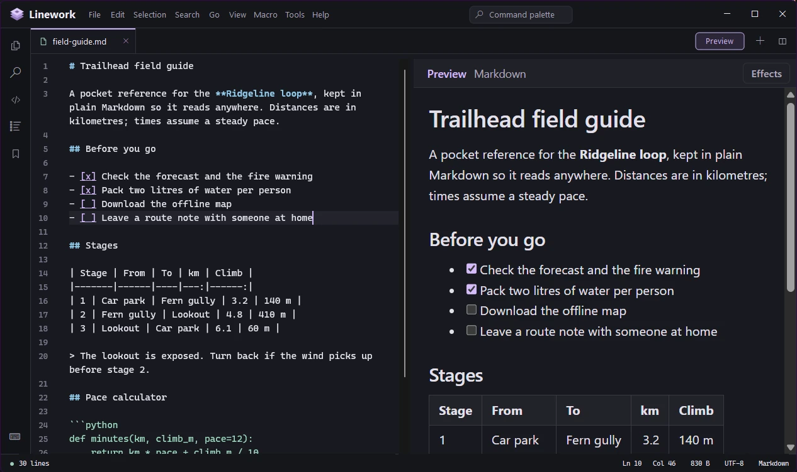
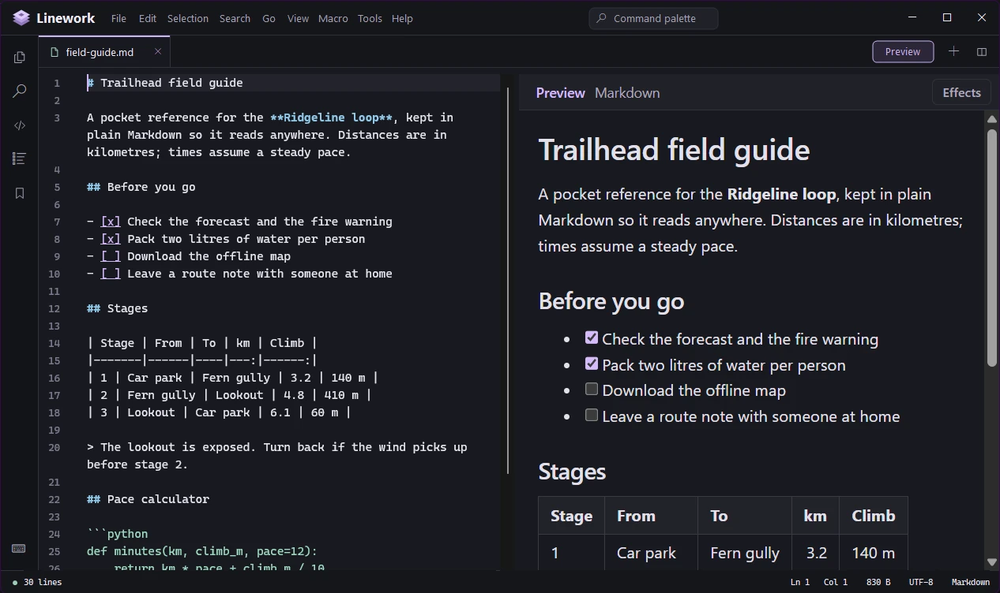
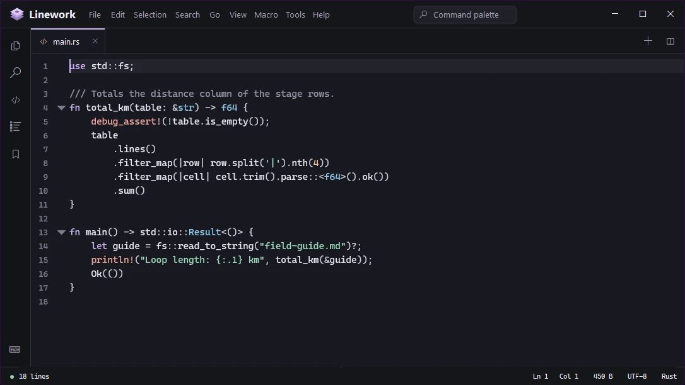
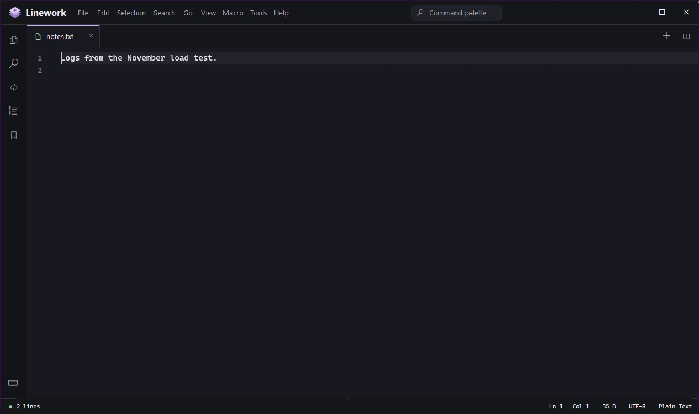
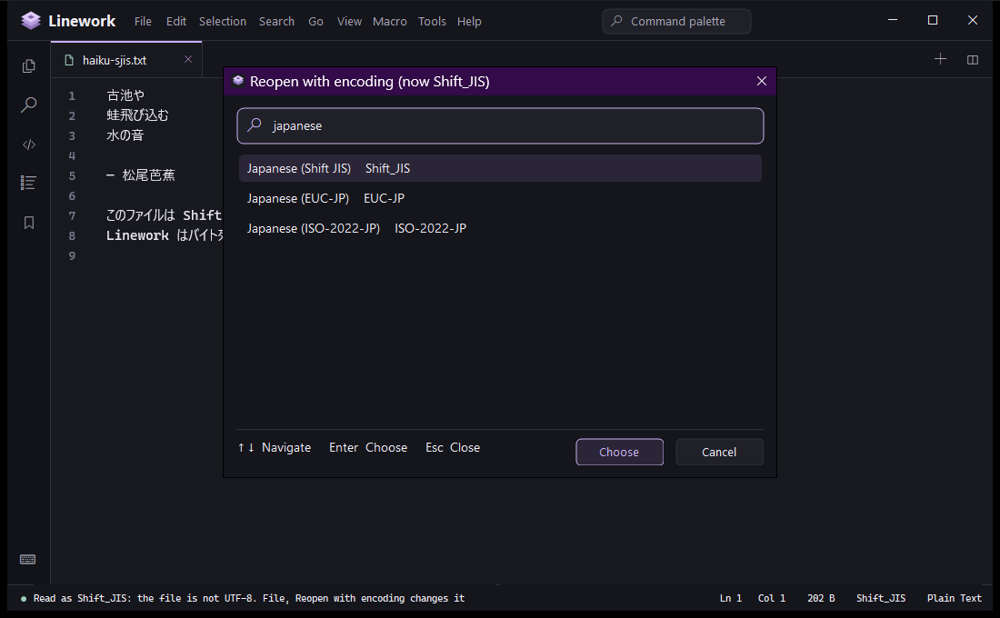
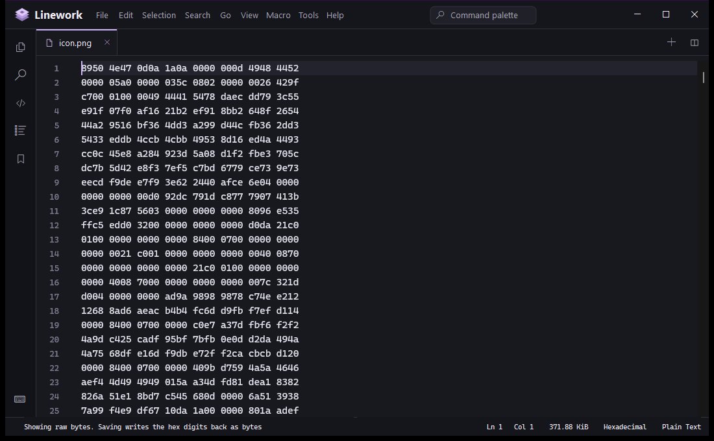
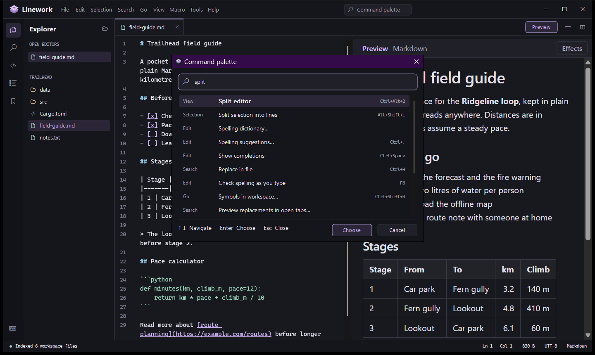

# Linework

**A fast, keyboard-first text editor for Windows.** 
Code, notes and multi-gigabyte logs in one window, with a live Markdown preview that keeps up as you type.

## Why Linework

- **Opens huge files instantly.** The end of a 3.2 GB log is on screen in under a second, using about 64 MiB of memory. Search, replace, multi-cursor editing, undo and save work across the whole file.
- **Live preview for Markdown, HTML, SVG, CSV and TSV.** Edits appear as you type, and the preview shows what changed without moving the page.
- **Markdown help built in.** Bold, italic and links on a selection, lists that continue themselves, and task boxes you can tick in the preview.
- **Encodings done right.** Files that aren't UTF-8 are recognized automatically, the Notepad++ and Sublime Text encoding list is one search away, and binary files open as editable hexadecimal.
- **Brings your extensions.** Runs x64 Notepad++ plugins and Sublime Text Python packages.
- **Never loses work.** Unsaved drafts survive crashes and restarts, and recovery checks the original file before using it.
- **Native and light.** A Win32 app written in Rust on Scintilla. No Electron, no background service.

## See it in action

### A preview that keeps up

New text arrives warm in the preview and settles into place. Deleted text floats away above the spot it left, so the page never jumps while you write.

### Markdown that types itself

Select a word and type `*` twice for bold, or `[` to make it a link. Enter continues numbered, bulleted and task lists, and Tab nests an item. Both ends of the markup around the caret light up so you can see what you're inside.

### Edit everywhere at once

**Ctrl+D** adds the next match to the selection. Type once and every caret follows. The caret glides between positions, so your eye never loses it.

### Files of any size

Linework reads large files straight from disk through a piece tree with a background line index, so a multi-gigabyte file opens in well under a second. Here a 2 GiB, 27-million-line log opens, takes an edit on its last line and jumps back to the top.

Measured for the launch film: each editor opened the same 3,221,225,600-byte UTF-8 log (25,165,826 lines) at its last line, run on its own with word wrap off, on Windows 11 with a Ryzen 7 9800X3D, 96 GiB RAM and NVMe storage, file already in the disk cache. Ready means the end of the file is on screen and the window has stopped changing. Lower is better.

| Editor | Time until the end of the file is on screen | Memory at that point |
|-|-:|-:|
| **Linework 1.7.0** | **0.91 s** | **64 MiB** |
| Notepad++ 8.9.9.1 | 3.28 s | 3,329 MiB |
| Sublime Text build 4215 | 71.0 s (49 to 78 s over five more runs) | 10,504 MiB |

### Encodings done right, and binary files too

Text that isn't UTF-8 has its encoding guessed from its bytes, and the status bar says which one was used. **Encoding → Reopen with encoding** lists the encodings Notepad++ and Sublime Text offer, filtered as you type. Binary files open as hexadecimal, and saving writes your edited digits back as bytes.

<table>
<tr>
<td width="50%"></td>
<td width="50%"></td>
</tr>
<tr>
<td align="center">A Japanese file detected as Shift JIS, with the picker filtered to <i>japanese</i></td>
<td align="center">A binary file in the hexadecimal view</td>
</tr>
</table>

### Keyboard first

Every command is in the palette, **Ctrl+Shift+P**, with its shortcut beside it, and any shortcut can be reassigned.

| To do this | Press |
|-|-|
| Find a command | Ctrl+Shift+P |
| Open a file by name | Ctrl+P |
| Go to a line, column, byte or percentage | Ctrl+G, then `120:8`, `@12582912` or `95%` |
| Add the next match to the selection | Ctrl+D |
| Add a caret above or below | Ctrl+Alt+Up / Ctrl+Alt+Down |
| Search a folder | Ctrl+Shift+F |
| Jump to a symbol, definition or reference | Ctrl+R, F12, Shift+F12 |
| Split the editor | Ctrl+Alt+2 |
| Record a macro, then replay it | Ctrl+Shift+M, then F9 |
| Show the Markdown preview | Ctrl+Shift+V |

## Also included

- Syntax highlighting for 55 languages, plus imported Sublime Text grammars
- Project search and replace with a review step before anything changes
- Side-by-side comparison with the saved file or any other file
- Folding, bookmarks, phrase marks in five colors, and a document map
- Offline spell checking with any Hunspell dictionary
- Snippets with linked placeholders, and macros you can inspect and edit
- Build commands with jump-to-diagnostic, and external tools that filter the selection

## Install

Run **Linework-Setup-1.13.1-x64.msi**. It installs for your Windows account only, without administrator rights, and adds Linework to Start, Default Apps and Explorer's **Edit with Linework** menu. Uninstall it from **Settings → Apps → Installed apps**; your documents and preferences stay where they are.

To build it yourself, see [CONTRIBUTING.md](CONTRIBUTING.md).

## Documentation

- **[User guide](USER-GUIDE.md)** covers every feature, setting and shortcut.
- **[Try the editor effects](docs/try-the-effects.md)** is a document to open in Linework that walks through each effect.
- **[Performance findings](docs/performance.md)** compares Linework with eleven other editors and `lw` with ripgrep on large files, and explains where the time goes on Windows.
- **[Notepad++ plugins](NOTEPAD-PLUGINS.md)** explains what the plugin host supports.
- **[External tools](crates/project/TOOLS.md)** shows how to run your own commands on a selection.
- **[Contributing](CONTRIBUTING.md)** covers building, testing and packaging.

## License

Linework is free software under the [GNU General Public License, version 3 or later](LICENSE). Bundled components keep their own licenses, listed in [runtime/licenses](runtime/licenses) and [runtime/python/LICENSE.txt](runtime/python/LICENSE.txt).
